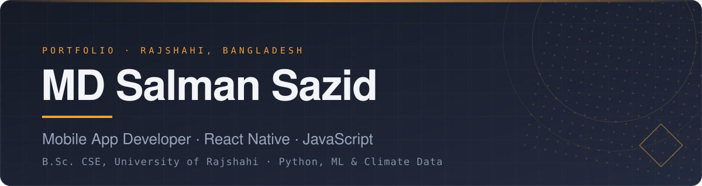

<!--
  ╔══════════════════════════════════════════════════════════════╗
  ║   Profile README · MD Salman Sazid                          ║
  ║   Edit the name, links and stack in the sections below      ║
  ╚══════════════════════════════════════════════════════════════╝
-->

<div align="center">

<a href="https://salman-sazid-007.github.io/portfolio/">
  
</a>

<p><b>Cross-platform apps that ship.</b><br/>
CSE graduate · University of Rajshahi · building e-commerce mobile products remotely for a US company</p>

<a href="https://salman-sazid-007.github.io/portfolio/"></a>
<a href="https://raw.githubusercontent.com/Salman-Sazid-007/Salman-Sazid-007/main/assets/Md-Salman-Sazid-CV.pdf"></a>
<a href="mailto:salmansazid70@gmail.com"></a>
<a href="https://www.linkedin.com/in/md-salman-sazid"></a>

<sub>📍 Rajshahi, Bangladesh · 🕒 Remote-friendly (UTC+6) · 🟢 Open to mobile & software roles</sub>

</div>

<p align="center">
  
</p>

## <samp>01 — Who I am</samp>

```js
const salman = {
  role:      "Mobile App Developer @ Fuego.io (USA, remote)",
  focus:     ["React Native", "E-commerce flows", "REST API integration"],
  education: "B.Sc. CSE, University of Rajshahi (2024) · CGPA 3.21 / 4.00",
  research:  "Long-term temperature forecasting · Prophet + XGBoost",
  values:    ["loading states", "empty states", "zero guesswork UX"],
  currently: "sharpening data-science and backend skills, one repo at a time",
  funFact:   "HSC and SSC both 5.00 / 5.00 — still overthinking border-radius",
};
```

I'm a Computer Science & Engineering graduate from the **University of Rajshahi**, working remotely as a **Mobile App Developer at [Fuego.io](https://fuego.io)**, USA. Over the past two years I've shipped cross-platform applications used by real customers — from the first wireframe to the store release.

My focus is **e-commerce**: product listings, carts, checkout flows and order management that stay fast and predictable under real-world conditions. Outside of work I research **climate modelling**, combining Prophet and XGBoost on NASA POWER data to forecast long-term temperature trends.

<table>
<tr>
<td width="50%" valign="top">

<b>What I'm good at</b>
<ul>
<li>Shipping React Native apps end-to-end</li>
<li>E-commerce UX — cart, checkout, orders</li>
<li>REST API integration &amp; state management</li>
<li>Turning a wireframe into a store-ready build</li>
</ul>

</td>
<td width="50%" valign="top">

<b>What I'm exploring</b>
<ul>
<li>MLOps &amp; model deployment for forecasting</li>
<li>Node.js / Express backends</li>
<li>Computer vision &amp; digital image processing</li>
<li>Clean architecture in mobile apps</li>
</ul>

</td>
</tr>
</table>

<p align="center">
  
</p>

## <samp>02 — Tech stack</samp>

<table>
<tr><td><b>Mobile</b></td><td>


</td></tr>
<tr><td><b>Languages</b></td><td>


</td></tr>
<tr><td><b>Web</b></td><td>


</td></tr>
<tr><td><b>Data &amp; ML</b></td><td>


</td></tr>
<tr><td><b>Databases</b></td><td>


</td></tr>
<tr><td><b>Tools &amp; platform</b></td><td>


</td></tr>
</table>

**Core CS foundations** — data structures & algorithms, OOP & design patterns, database systems (SQL/NoSQL), operating systems, computer networks & socket programming, compiler design, computer graphics, digital image processing, cryptography & network security, numerical methods, artificial intelligence, machine learning, blockchain fundamentals.

<p align="center">
  
</p>

## <samp>03 — Experience &amp; education</samp>

<details open>
<summary><b>Mobile App Developer — Fuego.io</b> · <code>Nov 2024 — Present · Remote · USA</code></summary>

<br/>

- Developed and maintained **cross-platform mobile applications** using React Native and JavaScript.
- Built **e-commerce features** — product listing, cart, checkout and order management — wired to live APIs.
- Collaborated with an international team remotely, shipping on schedule with daily and weekly updates.
- Owned the details that decide whether an app feels finished: loading states, empty states, error handling.

</details>

<details>
<summary><b>B.Sc. in Computer Science &amp; Engineering</b> · <code>2020 — 2024 · University of Rajshahi</code> · CGPA 3.21/4.00</summary>

<br/>

- Coursework in algorithms, data structures, databases, software engineering, AI and machine learning.
- **Undergraduate thesis:** Long-Term Temperature Forecasting using a Prophet + XGBoost hybrid model
  ([repo](https://github.com/Salman-Sazid-007/bangladesh-temperature-forecast)) — 64 district models, NASA POWER data,
  out-of-time MAE 0.99 °C, R² 0.92.

</details>

<details>
<summary><b>HSC &amp; SSC — Science</b> · <code>2018 — 2020 · Rajshahi University School</code> · GPA 5.00/5.00 (both)</summary>

<br/>

- Higher Secondary Certificate (2020) — GPA 5.00 / 5.00.
- Secondary School Certificate (2018) — GPA 5.00 / 5.00.

</details>

<p align="center">
  
</p>

## <samp>04 — Selected work</samp>

<table>
<tr>
<td width="50%" valign="top">

### 📱 E-Commerce Mobile App
*Professional · React Native*

Cross-platform shopping experience built at Fuego.io — product listing, cart, checkout and order management, wired to live APIs.

`React Native` `JavaScript` `REST API`

</td>
<td width="50%" valign="top">

### 🌡️ Bangladesh Temperature Forecast
*Research · BSc thesis · Python*

64 district-level Prophet + XGBoost models on NASA POWER data (1981–2015), evaluated out-of-time on 2016–2024. **MAE 0.99 °C · R² 0.92**, served as a static site with no backend.

`Python` `Prophet` `XGBoost` `Pandas`

[Live site](https://salman-sazid-007.github.io/bangladesh-temperature-forecast/) · [Code](https://github.com/Salman-Sazid-007/bangladesh-temperature-forecast)

</td>
</tr>
<tr>
<td width="50%" valign="top">

### 🧭 Rajshahi Tours &amp; Travels
*Full-stack · Node.js + vanilla front end*

Touring platform with a bilingual **বাংলা / EN** experience, destination search, journey filters, shortlists, accessible inquiry dialogs — plus an Express/MongoDB backend (JWT auth, bcrypt, helmet, CRM, SMS, accounting) and a **Tkinter + SQLite desktop counter app** that prints PDF receipts and ships as a Windows `.exe`.

`JavaScript` `Node.js` `Express` `MongoDB` `Python` `Tkinter` `SQLite` `PyInstaller`

[Live](https://salman-sazid-007.github.io/Rajshahi_tour_-_travels/) · [Code](https://github.com/Salman-Sazid-007/Rajshahi_tour_-_travels)

</td>
<td width="50%" valign="top">

### ✈️ Phoenix Travel Solutions
*Web · HTML / CSS / JavaScript*

Demo travel site with four interchangeable theme variants — a study in design tokens, theming and layout systems without a framework.

`HTML` `CSS` `JavaScript`

[Live](https://salman-sazid-007.github.io/phoenix-travel/) · [Code](https://github.com/Salman-Sazid-007/phoenix-travel)

</td>
</tr>
<tr>
<td width="50%" valign="top">

### 🎨 This Portfolio
*Web · hand-coded*

A responsive personal site with scroll reveals, count-up stats, a dual-tone design system and light/dark theming — no frameworks, no build step.

`HTML` `CSS` `JavaScript` `GitHub Pages`

[Live](https://salman-sazid-007.github.io/portfolio/) · [Code](https://github.com/Salman-Sazid-007/portfolio)

</td>
<td width="50%" valign="top">

### 🔐 crypto_all — Cryptography Lab Suite
*Academic · Python (stdlib only)*

Complete CSE-4232P collection: MD5, SHA-1, SHA-256, DES and Radix-64 written out step by step (not imported), plus 45 alternate wordings of every lab question and library-based versions. Fully self-testing.

`Python` `Cryptography` `Hashing` `DES`

[Code](https://github.com/Salman-Sazid-007/crypto_all)

</td>
</tr>
</table>

<details>
<summary><b>More labs &amp; coursework repositories</b></summary>

<br/>

| Area | Repositories |
| --- | --- |
| Machine learning | [`ml`](https://github.com/Salman-Sazid-007/ml) · [`AI-Lab`](https://github.com/Salman-Sazid-007/AI-Lab) · [`AI_Lab_Assingment`](https://github.com/Salman-Sazid-007/AI_Lab_Assingment) |
| Image & graphics | [`DIP`](https://github.com/Salman-Sazid-007/DIP) · [`Computer-Graphics`](https://github.com/Salman-Sazid-007/Computer-Graphics) |
| Signals | [`DSP_lab`](https://github.com/Salman-Sazid-007/DSP_lab) · [`DSP_Lab_final`](https://github.com/Salman-Sazid-007/DSP_Lab_final) |
| Systems | [`OS_Lab`](https://github.com/Salman-Sazid-007/OS_Lab) · [`Microprocessor_Lab`](https://github.com/Salman-Sazid-007/Microprocessor_Lab) · [`compiler`](https://github.com/Salman-Sazid-007/compiler) |
| Networks | [`Networking-lab`](https://github.com/Salman-Sazid-007/Networking-lab) · [`network-lab`](https://github.com/Salman-Sazid-007/network-lab) |
| Databases | [`ddbms`](https://github.com/Salman-Sazid-007/ddbms) · [`php_db`](https://github.com/Salman-Sazid-007/php_db) |
| Web & frameworks | [`web_dev`](https://github.com/Salman-Sazid-007/web_dev) · [`DjangoProject`](https://github.com/Salman-Sazid-007/DjangoProject) · [`laravel-main`](https://github.com/Salman-Sazid-007/laravel-main) |
| Blockchain & numerics | [`BC_lab`](https://github.com/Salman-Sazid-007/BC_lab) · [`Nunmerical`](https://github.com/Salman-Sazid-007/Nunmerical) · [`OOD`](https://github.com/Salman-Sazid-007/OOD) |
| C / C++ labs | [`PP_Lab`](https://github.com/Salman-Sazid-007/PP_Lab) · [`MC_Lab`](https://github.com/Salman-Sazid-007/MC_Lab) |

</details>

<p align="center">
  
</p>

## <samp>05 — By the numbers</samp>

<div align="center">

<table>
<tr>
<td align="center" width="25%"><h3>2+</h3><sub>years shipping<br/>apps remotely</sub></td>
<td align="center" width="25%"><h3>3.21</h3><sub>CGPA / 4.00<br/>B.Sc. CSE</sub></td>
<td align="center" width="25%"><h3>0.99&nbsp;°C</h3><sub>thesis MAE · R² 0.92<br/>64 district models</sub></td>
<td align="center" width="25%"><h3>5.00</h3><sub>GPA / 5.00<br/>HSC &amp; SSC</sub></td>
</tr>
</table>

<br/>


</div>

## <samp>06 — Let's build something</samp>

<div align="center">

I'm open to **full-time software and mobile development roles**, plus select freelance projects.
I usually reply within a day.

<a href="mailto:salmansazid70@gmail.com"></a>
<a href="tel:+8801727809737"></a>

<br/><br/>

<sub>© 2026 MD Salman Sazid · Rajshahi, Bangladesh · Built with a little Markdown and a lot of care.</sub>

</div>
